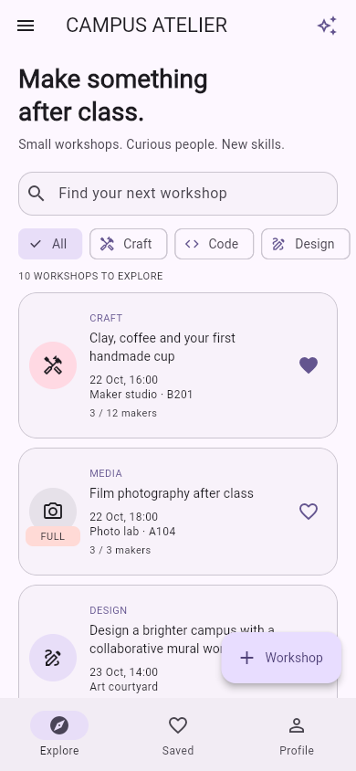
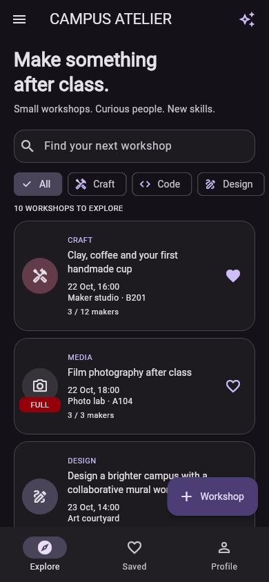
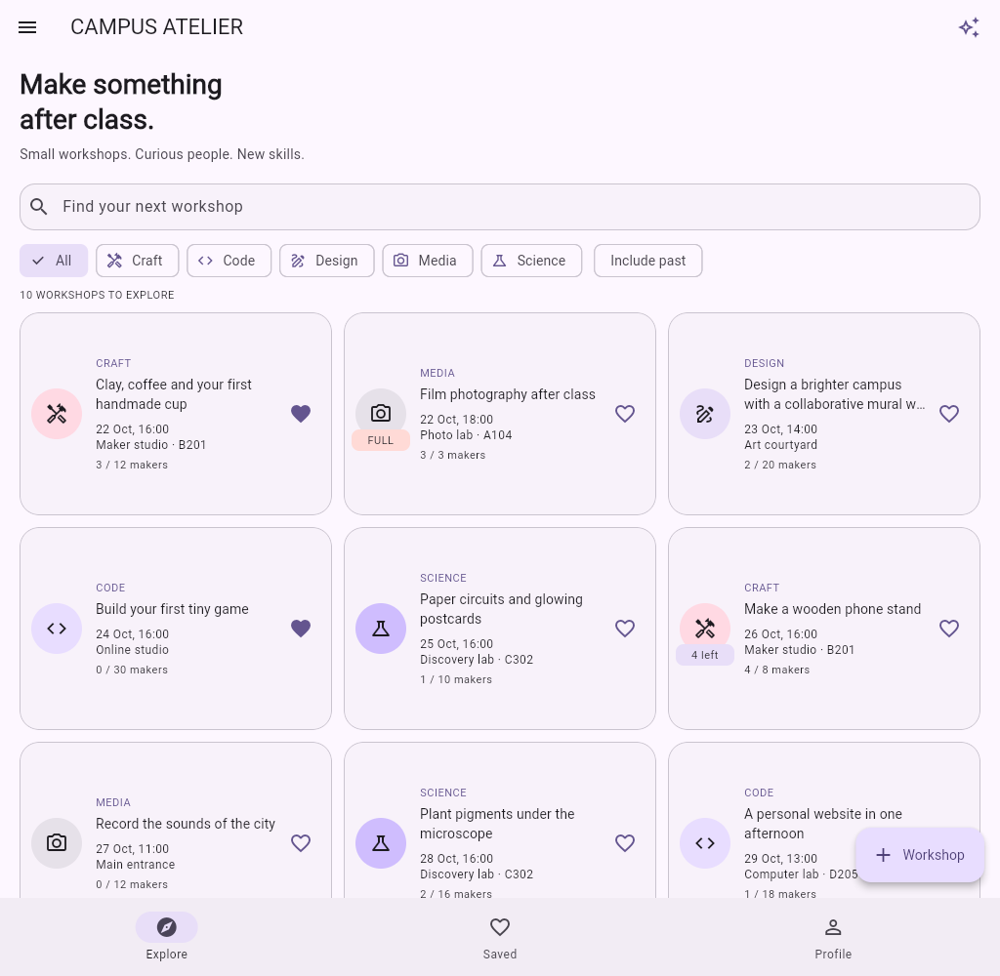

# Campus Atelier

Lab 01: a campus workshop app for students who want to make things after class. Discover craft, code, design, media and science sessions, save favourites and join a workshop using your maker profile. Workshops and the profile live only in memory; restarting the app or choosing **Reset data** restores the twelve seed workshops.

## Run

```powershell
cd lab01-campus-workshops
flutter pub get
flutter run -d chrome
```

For an Android emulator or connected phone, run `flutter run -d emulator-5554` or choose your device with `flutter devices`. Build an installable debug APK with `flutter build apk --debug`; the output is `build/app/outputs/flutter-apk/app-debug.apk`.

## Try it

1. Open **Profile**, enter a name and a group such as `KBTU-24`, then press Done or **Save profile**.
2. Open a workshop in **Explore**, choose **Join workshop** and confirm. The Makers tab updates immediately and marks your name with **You**.
3. Use the heart to save a workshop, then open **Saved**. Search, category chips and **Include past** work in both lists; swipe the chip row horizontally to reach all filters.
4. Use **+ Workshop** to create a session, or the detail menu to edit or delete it. Online mode requires a link containing `://`; a new session needs a future date and time.
5. Back out of a changed form to see **Discard changes?**. Restore the original values and the form is clean again. Saving takes one second and returns directly to the caller.
6. Try Light, Dark and System in **Profile**, or open the drawer for About and a confirmed data reset.

## Seed cases

All twelve dates are relative to the day the seeds are created. The mural workshop has a title of exactly 60 characters. Film photography has all three places taken. The zine and moving-shapes workshops are in the past. The tiny-game workshop is online. Paper circuits has no description. All five categories are represented, and three workshops start as favourites.

## Decisions

The workshop list and profile live in the shell State so all three tabs see the same source of truth.
The detail receives a workshop and callbacks to publish registrations, edits and deletion back to that owner while keeping its visible workshop current.
The form returns a Workshop through a typed named-route result so cancelling cannot mutate the original item.
The immutable model has a private const constructor and a public factory that defensively copies names into an unmodifiable list, preventing both direct mutation and mutation through a retained input list.
LayoutBuilder chooses the phone list or tablet grid from the actual available width, with enough columns to keep every cell at most 360 logical pixels wide.
PopScope compares a record of all current text, schedule, category and mode values with the record captured when the form opened, and an explicit save flag allows a validated save to pop without a discard dialog.
With week 9 tools I would introduce a shared state owner and a repository for asynchronous persistence, keeping the models and form validation independent of the storage implementation.

## Code map

| Requirement | Location |
| --- | --- |
| Immutable models, enhanced enum, records | `lib/models/workshop.dart`, `lib/models/profile.dart` |
| Twelve seeds and mandatory edge cases | `lib/data/seed.dart` |
| Sealed countdown and exhaustive rendering | `lib/models/countdown.dart`, `lib/screens/detail_screen.dart` |
| Date and padded time formatting | `lib/utils/format.dart` |
| Shell state, drawer and tab callbacks | `lib/screens/shell.dart` |
| ThemeMode above MaterialApp | `lib/main.dart` |
| Search, filters, copied sorting, LayoutBuilder | `lib/screens/workshop_list.dart` |
| Shared cards, Stack badges and empty states | `lib/widgets/` |
| Detail timer, tabs, live participants and dialogs | `lib/screens/detail_screen.dart` |
| Form validation, pickers, focus, async save, PopScope | `lib/screens/workshop_form.dart` |
| Profile submission, RegExp group, theme chips | `lib/screens/profile_tab.dart` |
| Route constants, typed arguments and Not found | `lib/routes.dart` |

## Validation

```powershell
dart format --output=none --set-exit-if-changed .
flutter analyze
flutter build web --no-web-resources-cdn
flutter build apk --debug
```

No test suite is added, as specified by the lab. Interactive checks cover profile submission, the empty-profile action, confirmed registration with a live Makers count, clean and dirty form exits, editing and saving, and phone/tablet layouts. The only dependencies are Flutter SDK and flutter_lints; date formatting and artwork are local, and the web build bundles its rendering resources for offline use.

## Screenshots

Actual browser captures of the running Flutter app. Phone: 390 × 844; tablet: 1024 × 1000 logical pixels.

### Phone light



### Phone dark



### Tablet grid


