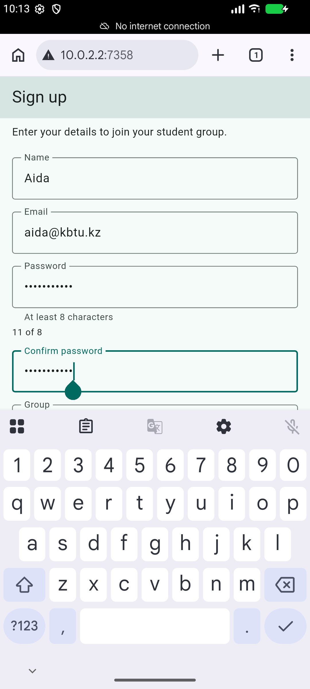
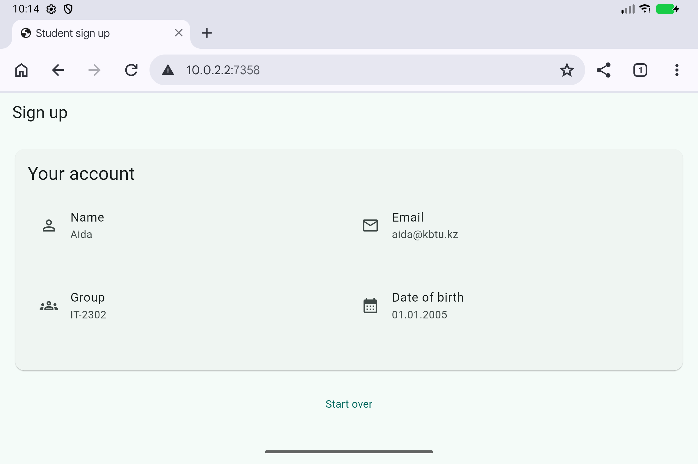

# Practice 07 - A Form That Validates Itself

A Flutter student sign-up screen implementing the final result of all five practice levels. The temporary if-chain and deliberately broken examples from the lab are replaced by the working Form implementation.

## Run

```powershell
cd practice07-a-form-that-validates-itself
flutter pub get
flutter run
```

Android, iOS, and web scaffolding is included. iOS builds require macOS and Xcode. Select an emulator/device or use `flutter run -d chrome`.

## Features

- Name, email, password, and confirmation fields have their own null-safe validators. Confirmation reads the password controller and updates when the password changes.
- One persistent Form key, one `validate()` call, and `AutovalidateMode.onUserInteraction` display errors beside the fields. Password length updates through `onChanged` and `setState`.
- Name targets the email FocusNode; keyboard actions continue through Password and Confirm. Done uses the same submit method as the button and respects the agreement checkbox.
- Email uses the email keyboard without autocorrect; passwords are obscured. Every text field dismisses focus on an outside tap.
- The form scrolls with 16 px padding and a fixed 24 px gap before the button, so the keyboard can reduce the viewport without overflow.
- The group dropdown and read-only birth-date field validate alongside the other fields. The date picker checks cancellation and mounted state before updating, preserves a previous date on Cancel, and formats dates as dd.mm.yyyy.
- The agreement checkbox enables or disables Sign up through its `onPressed` property.
- Successful submission shows Account created and replaces the form with SummaryCard. Its LayoutBuilder uses two grid columns when its own available width is at least 600 px; otherwise it uses a column.
- Start over clears every controller and resets group, date, consent, completion, and password count together. All controllers and the email FocusNode are created once in State and disposed there.
- No data is sent to a server or persisted. This is a local UI practice.

## Files

- `lib/main.dart`: app theme, sign-up form, input state, validation, date picker, submit, and reset.
- `lib/summary_card.dart`: immutable summary widget with a const constructor and responsive layout.
- `test/signup_test.dart`: validation, live password matching, picker cancellation, reset, keyboard actions, keyboard inset scrolling, and the exact summary breakpoint.

## Verify

```powershell
dart format .
flutter analyze
flutter test
flutter build apk --debug
```

Formatting and analysis passed, and all five widget tests passed.

## Android Java setup on this machine

The installed Java 26 failed Android's JdkImageTransform step. A portable [Microsoft OpenJDK 21](https://learn.microsoft.com/en-us/java/openjdk/download) is available in the ignored `.tools` directory of the parent workspace. System Java and Flutter settings were not changed. The Android build progressed with JDK 21 but needs the missing Android SDK CMake 3.22.1 package. Web is the selected run target. To retry Android after installing that SDK package, use a process-local override:

```powershell
$env:JAVA_HOME = (Resolve-Path "..\.tools\jdk21\jdk-21.0.12.1+1").Path
flutter run -d emulator-5554
```

On another machine, set JAVA_HOME to your own compatible JDK location. The portable JDK is outside this project and is not part of the submission.

## Submission

This folder belongs to the parent Flutter KBTU repository. Include the source, pubspec.lock, and required screenshots in your submission. Build products, SDK paths, local caches, and IDE files are ignored. No Git commit or GitHub push is performed automatically.

## Browser fallback

If `flutter run -d chrome` cannot attach its web debugger, start the server separately:

```powershell
flutter run -d web-server --web-hostname 127.0.0.1 --web-port 7357
```

Open http://127.0.0.1:7357 in Chrome. The five widget tests include the summary breakpoint and a simulated keyboard inset.

For a web build with local rendering resources, run `flutter build web --no-web-resources-cdn` and serve `build/web` using a static HTTP server. This was used for the Android-browser screenshots below because the emulator could not reach external resources.

## Required screenshots

Both images are actual captures of this Flutter web app in Chrome on an Android emulator, using sample student details. They are included in this folder and embedded below.

- `keyboard_open.png`: phone viewport, Confirm password focused, Android keyboard open, no overflow stripes.
- `tablet.png`: tablet viewport at 2400 x 1600 pixels, successful sign-up summary in two columns.

Keyboard Done was also verified to submit the completed form successfully. The emulator's display size and hardware-keyboard display preference were restored after capture.




