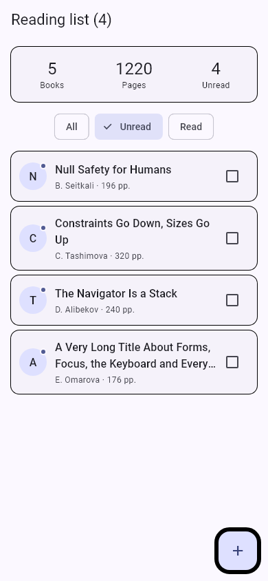
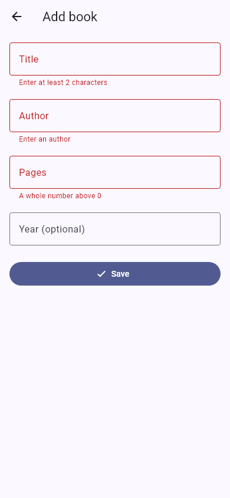

# Practice 08 — A Little of Everything

A Flutter reading-list app completing the final working result of Levels 1–5. It includes Android, iOS, and web project scaffolding. Books are held in memory and reset when the app restarts.

## Run

```powershell
cd practice08-a-little-of-everything
flutter pub get
flutter run -d chrome
```

For an Android device or emulator, use `flutter run` and select that device. iOS builds require macOS and Xcode.

If Chrome debugging cannot attach, use `flutter run -d web-server --web-port 7368`, then open the printed localhost URL in a browser.

The startup console prints:

```text
1220 pages, 4 unread
X — Y, 10 pp.
```

## Completed levels

1. **Plain Dart:** `models/book.dart` defines `Book`, `Book.fromMap`, the five seed books, nullable year formatting, and the `fold`, `where`, and ordered unique-author helpers. It imports no Flutter libraries.
2. **State:** `LibraryScreen` owns its books and enum filter. A switch expression selects the visible list, and the AppBar count follows it. Checkbox changes rebuild the list immediately. The state copies both the list and its mutable book objects; the assignment's shallow `[...seed]` alone would still allow toggles to mutate the seed objects.
3. **Layout:** `BookTile` has a const constructor, themed avatar and unread dot, an Expanded text column, a two-line title with ellipsis, author/page details, and a checkbox. The header divides its width among Books, Pages, and Unread. The filter row can scroll horizontally at narrow widths or larger text settings. Lists and forms scroll, including when the keyboard reduces the available height.
4. **Navigation:** tapping a card awaits `push<BookAction>`. The detail displays every field, including `Year unknown`, and returns an action without mutating the library. Delete requires confirmation. Both the dialog and route results check mounted state before continuing. Back and Cancel leave the list unchanged.
5. **Form:** Add book awaits `push<Book>`. Four State-owned controllers are disposed. Save validates all fields once, trims text, parses validated pages, and stores an empty year as null. Title needs two trimmed characters, author is required, pages must be a positive integer, and year must be empty or 1450 through the current year. Numeric keyboards, Next/Done actions, outside-tap dismissal, and inline automatic validation are implemented.

The only null assertion in `lib` is `currentState!` in Save. The temporary deliberately broken exercises are not left in the runnable app.

## Navigation stack

```text
LibraryScreen
  → DetailScreen       returns BookAction or null
      → Delete dialog  returns bool or null
  → AddBookScreen      returns Book or null
```

The dialog answers the detail; the detail answers the library. The library applies all changes with `setState` after awaiting a result.

## Verification

```powershell
dart format .
flutter analyze
flutter test
flutter build web --no-web-resources-cdn
```

Six tests cover model defaults and collections, filtering and seed isolation, back navigation, read status, deletion confirmation/cancellation, numeric validation, adding with a null year, cancelled additions, portrait/landscape layout, larger text, keyboard insets, and the two rendered previews.

The screenshot test loads Roboto and Material Icons from the Flutter SDK and app assets. Regenerate the previews after intentional UI changes with:

```powershell
flutter test test/screenshots_test.dart --update-goldens
```

## Required screenshots

These are 390 × 844 captures produced directly by Flutter's widget renderer, rather than emulator captures. Both have been visually inspected.

- `screenshot_list.png`: Unread selected, four books visible, long title wrapped to two lines with ellipsis.
- `screenshot_form.png`: Save pressed on an empty form, showing exactly three field errors and no year error.





Source files, tests, and screenshots are ready for submission in the parent repository. No Git commit or GitHub upload is performed automatically.
